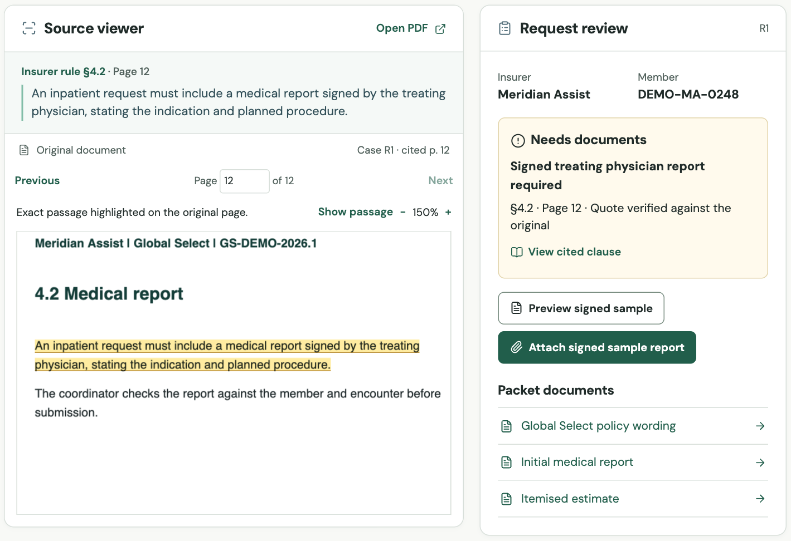
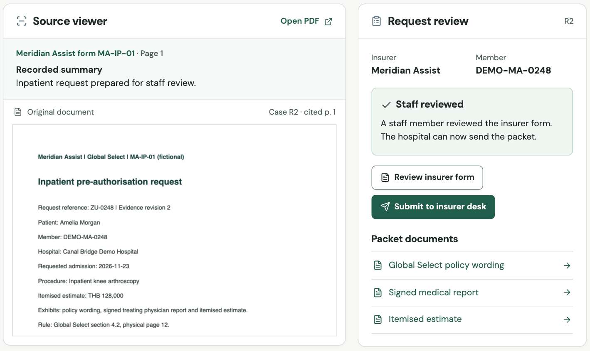
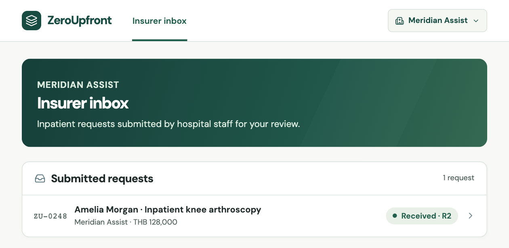

# ZeroUpfront

ZeroUpfront helps hospital staff catch missing evidence before an inpatient insurance request reaches the payer. A coordinator can open the exact policy clause, correct the packet and send the reviewed version to the insurer. At discharge, staff can trace a charge or payment discrepancy back to the original bill, clinical record or guarantee.

<a id="coordinator-workspace"></a>

## A case from hospital desk to insurer inbox

Amelia Morgan is a fictional patient at Canal Bridge Demo Hospital. Her knee arthroscopy estimate is **THB 128,000**, within her fictional Meridian Assist plan’s **THB 150,000** limit. The hospital still needs a signed medical report before it can submit her request.

**1. Find the missing signature.** On case **ZU-0248**, the hospital coordinator opens the cited policy clause. It says the treating physician must sign the report and specify the indication and planned procedure.



**2. Review the corrected request.** Attaching the signed report creates revision 2. The coordinator previews the insurer form, checks the supporting PDFs and marks that revision reviewed before submitting it.



**3. See what reached the insurer.** A separately signed-in Meridian Assist reviewer can open the submitted revision and its attachments. The hospital queue now shows **Waiting for insurer**. The payer makes the coverage and payment decision.



The 30-second captioned recording follows this case in a disposable hospital workspace and ends with a live test on US and Thai payer forms. [Recording guide](demo/README.md) · [Captions](demo/captions.srt)

<a id="run-the-demo"></a>

## Try the app

With Python 3.12, uv, Node 24 with npm, and PostgreSQL’s `initdb` and `pg_ctl` installed, start the synthetic two-hospital demo. The case above runs without an API key.

```sh
npm --prefix web ci
npm --prefix web run build
uv run --locked python -m app.hospital_demo
```

Open the hospital directory and select **Canal Bridge**, then open **Pre-arrival cases** for Amelia. The first interactive launch prompts for separate passwords for `judge` (hospital coordinator) and `reviewer` (insurer) in each hospital. If the host has already set up the demo, use the credentials they provide privately. [Local directory](http://127.0.0.1:8040/) · [Accounts and password reset](docs/hospital-workspaces.md)

| Another case to try | What to look for |
| --- | --- |
| **VISIT-CB-001** · Discharge | Find the repeated pharmacy charge on bill page 2, apply the corrected bill and preview the reviewed export with its original attachments. [Earlier discharge walkthrough (MP4)](docs/figures/discharge-walkthrough.mp4?raw=1) |
| **VISIT-CB-FX** · Settlement | Inspect the guarantee, compare the dated ECB reference from Frankfurter with simulated bank offers, and reconcile a THB 238,700 receipt against a THB 239,000 guarantee. [Pattaya rehearsal](docs/demo.md#pattaya-fx-rehearsal) |

## Where OpenAI fits

OpenAI can transcribe scanned pages, read Thai or English guarantee wording about exchange fees, and give a second reading of supported payer forms with page citations. Staff can inspect the original PDF beside each finding. Python checks identifiers and amounts, and PostgreSQL keeps the reviewed revisions and sources in a separate database for each hospital. [Model evaluation](docs/payer-review-design.md) · [Architecture](docs/architecture.md)

## Human review after discharge

When a payer asks a question or declines a claim, the coordinator can record the follow-up owner, due date and the exact reply sent. A coordinator reviews the Thai/English patient statement before sharing it. New receipts trigger another review. Finance staff can read the balance for an assigned case. [Discharge follow-up guide](docs/demo.md#human-review-after-a-payer-reply)

## What we measured

| Test | Result |
| --- | --- |
| Synthetic AIA Thailand, US CMS-1450 and BCBS FEP claims on known form layouts | The current regression located **11/11** target issues on the correct page, with **6/6** exact changed-value citations, **0/45** false alerts on aligned fields and **14/14** unverified cases held. A fresh panel passed **8/8** payee and amount checks. [Holdout](docs/payer-holdout.md) · [Fresh panel](docs/payer-confirmation.md) |
| 10,000 synthetic inpatient encounters | All **760** timed HTTP requests passed. The restore recovered **11,040** revisions and **47,048** original PDF blobs. Median worklist render time was **0.82 seconds** on the test machine. [Database benchmark](docs/discharge-scale-benchmark.md) · [Browser measurements](docs/ux-redesign.md) |

Actual payer acceptance and hospital staff time savings have yet to be measured. [Scaling benchmarks](docs/scaling.md) · [Deployment](docs/deployment.md) · [Security and encryption](docs/security-and-encryption.md) · [Privacy by jurisdiction](docs/privacy-by-jurisdiction.md)

## Hackathon declaration

The team planned the workflow before the event. At the Bangkok kickoff on 21 November 2026 the repository held a README, demo outline, ignore rules and an empty app directory. During the hackathon the team built the evidence checks, revision history, hospital and insurer workspaces, reviewed exports, settlement rehearsal and synthetic test cases. The declaration identifies the public payer forms, supplied sample corpus, open-source components and OpenAI services used. [Build declaration and evidence](docs/hackathon-declaration.md) · [Third-party credits](THIRD_PARTY.md) · [Contributor setup](CONTRIBUTING.md)
