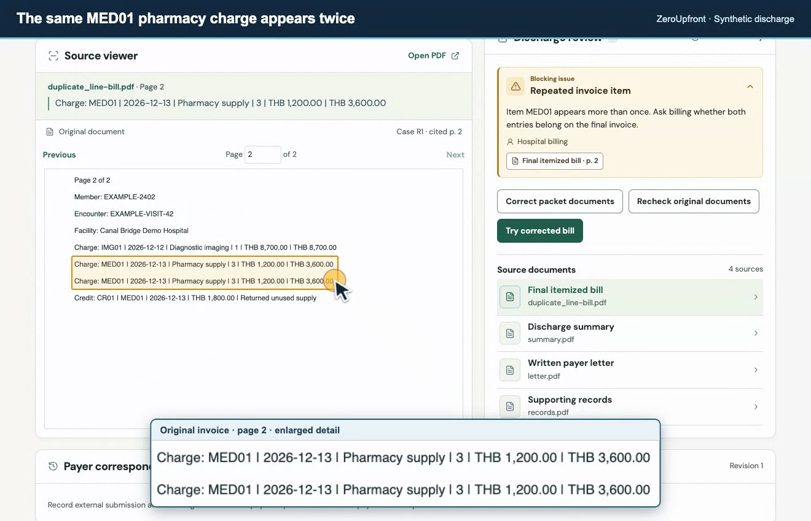

# ZeroUpfront

ZeroUpfront helps hospital billing coordinators catch problems in an inpatient insurance claim before they send it to the payer. At discharge, someone has to reconcile what the hospital billed, what the clinical record supports, what the insurer authorized and who should receive payment. A repeated pharmacy charge or a payment assignment naming a different hospital can send staff back through the whole packet.

The workspace puts each discrepancy beside the original PDF page. A coordinator can inspect the evidence, request a correction, review the new revision and export the packet with its original attachments. Staff record external submission, the insurer’s written decision and actual payment separately. The insurer decides what it will pay. [Watch the walkthrough with visible clicks (MP4)](docs/figures/discharge-walkthrough.mp4?raw=1) · [View the animation (GIF)](docs/figures/discharge-walkthrough.gif) · [Follow the case through a simulated payment](docs/demo.md)

[](docs/figures/discharge-walkthrough.gif)

<a id="coordinator-workspace"></a>

## Run the demo

The local rehearsal uses fictional patient and billing data and works without an API key. From the repository root, with Python 3.12, uv, Node 24 with npm, and PostgreSQL’s `initdb` and `pg_ctl` on your PATH, run the following as a regular user.

```sh
npm --prefix web ci
npm --prefix web run build
uv run --locked python app/run_workspace.py
```

1. Open the [local discharge worklist](http://127.0.0.1:8038/) and choose **Try duplicate bill example**.
2. Open the finding. Page 2 shows the same pharmacy item twice. Choose **Try corrected bill**, inspect the replacement, confirm it belongs to the encounter and select **Save corrected packet**.
3. Choose **Review discharge packet**, review the attachments and select **Mark packet reviewed**. Open **Claim and attachments** to preview the originals or download the reviewed PDF. **Version history** still opens the first bill.

For the pre-arrival hospital and insurer design prototype, open the [two-workspace review guide](docs/workspace-review/README.md).

## Where OpenAI fits

For supported scans, OpenAI transcribes the page so staff can compare the text with the original. An optional multimodal second read inspects Thai and US payer forms and returns observations with page citations. Python checks identifiers and amounts with explicit rules. The FastAPI service stores revisions in PostgreSQL, and the React workspace uses PDF.js to show the original page. Staff sign off on a specific revision. The second read cannot approve a claim or assign a payable amount. [Model evaluation and design](docs/payer-review-design.md)

## What we verified

The supported-format rehearsal runs from correction through review, export and simulated settlement. Separately, we filled published AIA Thailand, US CMS-1450 and Blue Cross Blue Shield Federal Employee Program forms with synthetic cases to test where screening should stop. On the **first blinded holdout**, the field readers identified **10 of 11** expected outcomes on the correct page. They missed a different named payee. After fixing that and a cents citation, a **fresh panel passed 8 of 8** payee and amount checks on its first run. All eight unverified claims stayed on hold. Actual payer acceptance and staff time savings remain unmeasured. [Blinded results](docs/payer-holdout.md) · [Fresh confirmation](docs/payer-confirmation.md)

## Hackathon build declaration

The team planned the insurance workflow before the event. At the 10:00 Bangkok kickoff on 21 November, the public repository contained a README, a demo outline, ignore rules and an empty application directory. Later commits added the coordinator worklist, revision history, field checks that cite original pages, reviewed export, and separate records for payer decisions and payments. [Pre-kickoff snapshot](https://github.com/aowngong/ZeroUpfront/tree/2bdede36e2df9f917025d415e4c8bc5b5e5c452c) · [Organizer agenda and FAQ](https://luma.com/39zve8ph)

The team built on open-source libraries, OpenAI services, public payer forms and a supplied sample corpus. The team added the claim workflow, reconciliation rules and synthetic cases that test them. [Full build declaration and evidence](docs/hackathon-declaration.md) · [Third-party credits](THIRD_PARTY.md)

One Codex-assisted fix began with a missing supporting page. The model correctly read two different member IDs but linked only the claim form. The resulting change also locates the hospital’s ID on the invoice for the same encounter. Replaying six saved responses from three synthetic packets verified both pages for the CMS member and AIA admission comparisons. [See the CMS finding in the app](docs/figures/cms-member-evidence.png) · [Code change](https://github.com/aowngong/ZeroUpfront/commit/b4d21f1334f96a03d87c93addf2d5188b2caca9b) · [Replay the evidence](bench/payer_citation_replay.py)

[Setup and contributor runbook](CONTRIBUTING.md) · [Staff deployment](docs/deployment.md) · [Open-source components, licenses, services and form sources](THIRD_PARTY.md)
