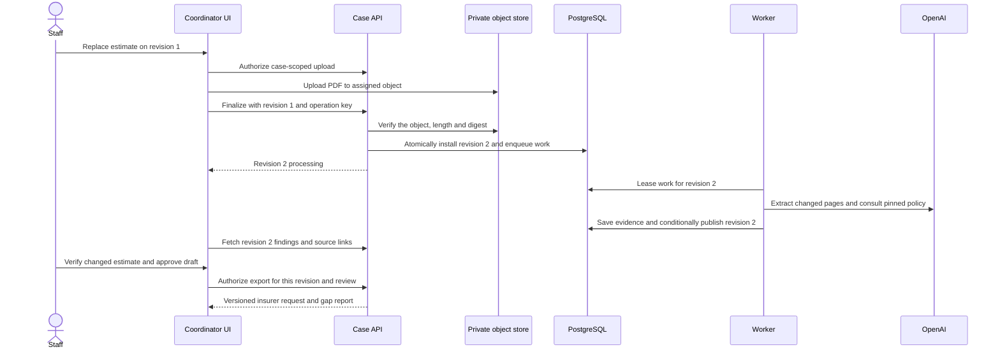

# Building the coordinator application

This 21 November 2026 design describes the proposed pre-arrival workflow and its scale-up targets. The released app serves pre-arrival and discharge cases, accepts multipart PDF uploads, preserves each revision and its original PDFs in PostgreSQL, and supports staff-reviewed export. The sequence below proposes object storage and a separate worker. Isolated benchmarks exercised revision and lease behavior. The current local demo starts on the discharge worklist. [Try the workspace](../README.md#run-the-demo) · [Release and deployment](deployment.md) · [Revision experiments](case-revision-guards.md)

## Proposed staged upload and worker sequence

A staged object becomes a case exhibit only after finalization. Bind it to the encounter using an independently sourced encounter ID or explicit coordinator confirmation. A member ID alone can match two admissions. An ambiguous upload stays pending without changing the active estimate. The finalization transaction binds the immutable object, the active manifest, the superseded estimate and the durable job. If the client disappears after uploading, expire that unused upload. If it disappears after committing, a retry of the same operation key and payload returns the recorded revision. A reused key with different content fails. Revision conflicts require the coordinator to see the new active estimate before choosing which document to replace. [HTTP conditional requests](https://www.rfc-editor.org/rfc/rfc9110.html#name-if-match) · [PostgreSQL row locks](https://www.postgresql.org/docs/current/explicit-locking.html#LOCKING-ROWS)

## Proposed service contracts

| Resource | Fields that determine correctness | Main consumer |
| --- | --- | --- |
| Case and revision | Hospital, case ID, current revision, monotonically increasing revision number, active exhibit IDs and roles, supersession links, pinned policy editions and riders. Each manifest is immutable. | Intake, queue and reviewer. |
| Artifact and extraction | Hospital, immutable storage version, byte digest, MIME/type, page count, reader/model/schema version. Each extracted fact keeps the source digest, physical page, quote and uncertainty. OCR and table structures stay reproducible for that version. | Document jobs and PDF viewer. |
| Policy edition and rule | Insurer, plan option, effective dates, original and rider digests, reviewed rule version, source spans and dependency IDs. A patient-supplied rider stays case-scoped pending verification. | Rule selection, retrieval and underwriting exceptions. |
| Check and finding | Revision, manifest hash, policy/rule versions, checker/prompt/model, lease, run state, typed facts, unresolved inputs, checked quotes and CTA for the coordinator. Use decimal money with currency and distinguish null from zero. | Review queue and result publication. |
| Human review and export | Actor, timestamp, manifest hash, run ID, accepted findings and overrides with reason, template version, generated object digest. A revision change needs a new review. Preserve historical files and link submissions to the actual version sent. | Writer, reviewer and audit. |
| Insurer response | Submission ID, letter digest, effective interval, currency, amount and terms, response status and event time. Record receipts separately from approved amounts. | Admission comparison and tracker. |

Authorize each resource in its hospital and case before returning an upload target, source page or export. Use a server-held project credential for AI calls. Only approved policy editions may be shared across cases in a searchable library. Store clinical documents privately and keep proposed OCR facts in their case's access scope. For the event use synthetic cases. Confirm deployment arrangements before processing identifiable records.

| API operation | Contract in the proposed design |
| --- | --- |
| Create a case and read the queue | Return the case ID, current revision, document-processing state, review outcome and insurer response independently. Queue filters can identify cases needing staff action or waiting on an insurer. |
| Begin upload; attach or replace an exhibit | The server chooses the storage location. Finalize with a strong current-revision precondition, operation key, role and optional replaced exhibit ID. Return the new revision and job, or a replayed result. A stale precondition yields HTTP 412. |
| Get review and source page | Fetch an explicit case revision and its checks. Each finding exposes its source page, document version, original quote and visible reason for review. A source link remains tied to that exhibit across revisions. |
| Approve and request export | Require the same current revision and verified run the coordinator saw. Serialize approval and revision changes on the case. Recheck the guard on artifact publication and on requests for the current export. Route current downloads through an authorization and revision check every time. A signed URL handed out for an earlier artifact can remain valid until its expiry. For historical access, authorize the old artifact explicitly and label its revision. |
| Record an insurer response | Require a submitted revision and documentary evidence. Keep local packet readiness and the insurer's disposition as independent records. A later change to the estimate leaves the earlier insurer letter tied to its original submission. |

## How the worker should decide

1. Choose the policy edition and riders with the coordinator's confirmed member schedule and service date. Missing, conflicting or expired inputs create a visible gap. A successful eligibility inquiry or a submission receipt does not establish a guarantee.
2. Reuse case-document extraction within the authorized case and reader version. A cross-case cache hit, if introduced later, must reauthorize the artifact and verify the encounter binding. Fan out independent pages and supplements within provider limits. Quarantine unsupported or unreadable inputs, and reconcile identifiers, currencies, column headers and totals before proposing a figure.
3. Resolve any supported workflow's required base clauses, exclusions and riders from the reviewed map. Use the full applicable edition for a bounded open question. Search supplies candidate passages for an independent check. Count the complete request, including case exhibits, instructions and answer allowance. If the governing documents do not fit, group by contract section while retaining the dependencies. Escalate missing evidence to staff.
4. Validate dates, thresholds, line items, currency, citations and packet identity in code. Keep a typed field for the proposed amount. For each material field, retain the operative source span, what rule or table column it applies to and any exception needed to interpret it. The PDF viewer should open that span. A page-level anchor alone can point staff to the correct page while omitting a second operative clause on it. A correct number with the wrong member, edition, unit or clause cannot produce a ready-to-review packet. The [US source audit](us-hybrid-decision.md) supports a primary full-edition read followed by an independent field-specific read over search hits and the primary reader’s pages. Require typed agreement and validate the source for each material field before displaying its finding. Semantic support for a claim can still require staff judgment.
5. Append the result against its original manifest. Publish it to the current review screen only while the case still points to that revision, every required exhibit is complete, and the job owns its unexpired lease and current attempt token. Reclaiming an expired lease increments that token, fencing a previously stalled worker out of publication. Record stale completions for diagnosis. Retriable provider failures use bounded backoff. An exhausted job leaves the active revision in a recoverable failure state.
6. The writer fills insurer-specific fields from the verified snapshot. An absent required signature or amount blocks a submission-ready export. Show permitted provisional amounts as provisional. Staff review the original source pages and approve each request in the demo.

## What the coordinator sees

| Situation | Screen behavior and primary action |
| --- | --- |
| Initial estimate contains a total only | Show “Itemized estimate needed,” the governing clause and the estimate page side by side. Offer **Replace estimate**. |
| Replacement uploaded | Show the new revision as processing and permit page inspection. Move the prior check to history. Keep the current export action unavailable until its own review completes. |
| Corrected estimate totals the same amount | Show the line-item change and which gap it resolved. Preserve the old PDF and the new PDF. Require review of the new source even when the total is unchanged. |
| Conflicting source, unclear digit or incomplete evidence | Show the unresolved field and linked pages, who can resolve it and what document would resolve it. An annotation can record what staff verified. |
| Insurer replies, or the estimate changes after a letter | Open the insurer letter alongside the revision it covers. Show changed dates, procedure or amounts and let staff prepare a follow-up revision. |

## Original integration plan

Start with one deployable Python codebase, a web process and a separately scalable worker, managed PostgreSQL, private versioned object storage and the OpenAI API. Serve the React/Vite UI and FastAPI endpoints from the same origin. PostgreSQL owns the revision write and queue entry in one transaction. Use short database leases and call the provider outside the transaction. Bound workers by the API project's token and request budgets. Observe queue age, failed or stale completions, invalid citations, unsupported assertions, reviewer corrections and time to a reviewable packet. Emit identifiers and timing to telemetry; keep claim text and monetary evidence in the authorized case records. [OpenAI rate limits](https://developers.openai.com/api/docs/guides/rate-limits) · [Earlier architecture and scaling rationale](architecture.md)

| Owner | First integrated slice | Acceptance demonstration |
| --- | --- | --- |
| Tech lead | Own case/revision contracts, conditional writes, checker integration and release. | A delayed old worker cannot make an earlier packet current. A retry produces one logical outcome. A stale approval or export fails visibly. |
| Frontend teammate | Deliver queue → case → source page → replacement → review against the same API contract. | The reviewer can tell which file changed and open every displayed quote. Browser refresh shows the active revision and correct actions. |
| Policy/data teammate | Own fixture labels, versioned rule dependencies, template field mapping and independent source review. | A supported case renders a verified request. A missing signature, mixed encounter or absent rider creates the expected blocking finding. |

Integrate the missing-estimate path first, then the exclusion and dated-rider cases. Before a shared pilot, exercise actual object storage, an authenticated upload and a browser export during a revision race. The [replacement experiment](same-case-revision.md) and [encounter, lease and export trials](case-revision-guards.md) exercise the state transitions at the database boundary. A pilot also needs independent coordinator labels and a reviewed template for each participating insurer. [Original project scope and fixture evidence](document-research.md)
