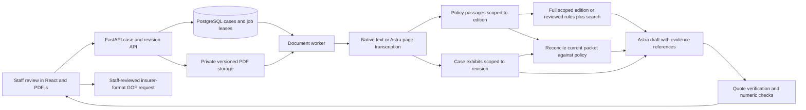

# Building ZeroUpfront

Engineering recommendation · 21 November 2026

A hospital coordinator has a treatment plan, estimate and policy. The most useful screen answers three questions in order. What holds up this request? Where is the evidence? What can I do next? For the two-minute demo, follow one missing estimate through correction and staff review. The insurer owns the eventual guarantee of payment (GOP). Keep the hospital's pre-check result and the insurer's response as separate fields throughout.

## Stack to assemble

| Layer | Choice for the first shared application | When the choice changes |
| --- | --- | --- |
| HTTP and UI | FastAPI for the case API; React with TypeScript, Vite and PDF.js for the staff review screen. Keep selected finding, page and zoom in the browser. Keep case status, source documents and revisions authoritative on the server. Serve the compiled UI and API from the same origin. | For a form-only pilot, server-rendered HTML remains simpler. With a source-linked document viewer, the React client earns its place. Route directly to a case, finding and page so that refresh and shared review links preserve context. [React with Vite](https://react.dev/learn/build-a-react-app-from-scratch) · [PDF.js examples](https://mozilla.github.io/pdf.js/examples/) |
| Intake and Reader | Preserve each original PDF and physical page number. Use pypdf for clean selectable text. For scanned, mixed or damaged pages, pass a single-page PDF to GPT-6.2 Astra via Responses. Request a transcription in the original language and a legibility status. | Staff resolve unclear digits and unsupported quotes against the original. Benchmark the model on short text, long tables and bilingual documents separately. [OpenAI PDF inputs](https://developers.openai.com/api/docs/guides/file-inputs) · [Vision limitations](https://developers.openai.com/api/docs/guides/images-vision) |
| Rulebook and Checker | The live CLI pins the synthetic policy edition and presents all eight pages to Astra by default. Search mode uses an OpenAI-hosted index and reranks candidates with explicit text-embedding-3-large embeddings. A deterministic calculator reconciles the supported case layouts before Astra drafts findings from the case and policy exhibits. | Evaluate dual retrieval of base clauses and endorsements on new policy editions. Clinical and insurer decisions remain with their respective reviewers. [OpenAI embeddings](https://developers.openai.com/api/docs/guides/embeddings) |
| Persistence | PostgreSQL from the first shared deployment, SQLAlchemy with a session per unit of work, Alembic migrations. Store packet metadata, jobs, decisions and history in one database. | SQLite is attractive for a local demo but serializes writes. A shared queue and concurrent staff edits justify PostgreSQL at the start. The fixture CLI runs directly from files. [SQLite concurrency guidance](https://sqlite.org/whentouse.html) · [SQLAlchemy sessions](https://docs.sqlalchemy.org/en/20/orm/session_basics.html) · [Alembic](https://alembic.sqlalchemy.org/en/latest/tutorial.html) |
| Artifacts and Writer | Give every original upload a digest, immutable key and page count. Use a private directory locally and a private object bucket for multiple instances. Render staff-reviewed fields into a versioned ReportLab template per insurer. | Retain the exact generated PDF and its input revision so a future insurer query can be traced to the packet actually sent. A template change only affects new drafts. [ReportLab document templates](https://docs.reportlab.com/reportlab/userguide/ch4_platypus_concepts/) |
| Runtime and measurements | One codebase, separately startable web and worker processes. Keep dependencies in a uv lockfile. Record queue wait, PDF read, model, verification and rendering as distinct spans. | Add workers when queue wait grows and provider capacity permits. Introduce a separate queue service only after measuring a database bottleneck. [uv lock and sync](https://docs.astral.sh/uv/concepts/projects/sync/) · [OpenTelemetry Python](https://opentelemetry.io/docs/languages/python/) · [OpenAI rate limits](https://developers.openai.com/api/docs/guides/rate-limits) |

The preparation deliverable is a CLI tested against OpenAI-hosted OCR, retrieval, embeddings and drafting. The event build would add the staff web app, shared case tracker and GOP Writer. The preparation run deployed no web app. The proposed application frameworks, database and PDF tools are open source. [Hosting and credits](cloud-rag.md)

For supported administrative checks, pin the original PDF and maintain a reviewed JSON rulebook that enumerates each required clause and endorsement. Search adds context for open questions. [Representation decision and source research](policy-representation.md)

The [benchmark comparison](benchmark-comparison.md) supports full-edition reading for bounded open questions, plus verified, mandatory clause links for supported checks. [Context budgets](context-budget.md) should be applied to the full request including case evidence.

## Proposed application design

**Preparation prototype, hosted-search measurements.** The original live fixture suite passed all six scenarios. The optional search route indexes two eight-page synthetic policy editions in one managed store. Each search filters on one edition and source digest. It combines hosted search rank with cosine rank from text-embedding-3-large, then supplies up to four policy passages and the five-page case to Astra. The calculator supplies the draft amount or an unresolved result before generation. The verifier checks the typed amount, policy and case quotations, and clause identifiers. A quote from OCR still needs the page image to confirm uncertain digits. The live Thai run with one scanned statement page returned a THB 141,800 staff draft in 20.180 seconds. This is one observation. [Document research](document-research.md) · [Bilingual model comparison](embedding-eval.md) · [Financial baseline](finance-gate.md)

**Storage and scaling.** The demo keeps source PDFs on disk and uploads only synthetic policy passages to the managed store. Each indexed passage carries its page, reference, edition and digest. In these short editions, hosted search can return few candidates for a Thai query against English policy wording. When that happens the CLI can include the remaining indexed passages of the same edition before reranking. The managed path embeds its candidates and query per search. SQLite caches explicit policy embeddings only in the separate application-controlled comparison. For a larger library, measure recall and per-query cost on long editions before choosing candidate count or adding a reranking cache. The proposed PostgreSQL service owns cases, revisions and authorization. A self-managed index such as pgvector remains an option if measured workload or data controls justify running it. Automatic member-to-edition resolution remains future work. [Hosted search, limits and retention](cloud-rag.md) · [pgvector](https://github.com/pgvector/pgvector)

**What a coordinator sees.** Each finding should open its cited page beside the case document. A refusal, unreadable page, unresolved jurisdiction or unsupported quote returns the case to staff. Medical eligibility and insurer settlement remain separate from administrative packet readiness. The React viewer, shared API, durable worker and export flow in the diagram are proposed implementation work.

## Patterns from comparable products

| Reference | Publicly documented behavior | How to adapt it |
| --- | --- | --- |
| Bumrungrad International Hospital | Its Bangkok finance guidance describes contracted versus non-contracted arrangements, requests for guarantee letters, and circumstances where a deposit is required. | Closest reference for the actual user. Show settlement arrangement, deposit requested, guarantee received and patient responsibility separately. [Hospital finance guidance](https://www.bumrungrad.com/th/medical-travel/patient-finance-insurance-information) |
| Availity Essentials | A shared provider portal supports eligibility, authorization requests, status inquiries and payer-specific spaces across plans. | Best queue and navigation reference. Keep one case workflow, with the selected insurer controlling required exhibits and output format. [Portal documentation](https://essentials.availity.com/availity/help-open/oxy_ex-1/onb-essentials-provider-help/about_availity/_topics/c_multi_payer_portal.html) |
| Waystar | Its authorization platform covers determining requirements, initiating authorizations and monitoring work for providers. | Best reference for prioritizing staff effort. Start the review on the actionable exception and track time to resolve it. Vendor outcome metrics are unsuitable as ZeroUpfront benchmarks. [Waystar authorization platform](https://www.waystar.com/our-platform/financial-clearance/authorizations/) |
| Candid Health, YC W20 | Its API models a task that can block submission and a submission history that can contain several attempts per encounter. | Give every gap an action, owner and blocking flag. A document correction creates a new revision of the same case. Keep submission attempts and insurer acknowledgments separate. [YC profile](https://www.ycombinator.com/companies/candid-health) · [Task API](https://docs.joincandidhealth.com/api-reference/tasks/v-3/create) · [Claim lifecycle](https://docs.joincandidhealth.com/data-share/claim-lifecycle/overview) |
| Saga AI, YC W24 | Saga describes reading incoming forms, requesting missing records, tracking prior authorization and asking staff to approve sensitive actions. | Close the gap inside the review screen. After staff upload a revised estimate, show which requirement it resolved and who reviewed the packet. [YC profile and product description](https://www.ycombinator.com/companies/saga-ai) |
| Stedi, healthcare eligibility portal | Stedi documents a list of checks, a result banner, errors beneath it, and drill-down into benefit details. | Lead with “Itemized estimate needed.” Put the quote and page link directly below the blocker. Keep member and policy metadata in a collapsible detail section. [Portal walkthrough](https://www.stedi.com/docs/healthcare/eligibility-portal-benefits-view) |

For the pitch, use Bumrungrad for the hospital process, Availity for the multi-insurer workflow and Candid Health for blocking tasks and revision history. The database and UI proposed above are our design choices. A US prior authorization can be a condition of coverage. A Thai hospital also needs to establish the settlement arrangement and what the insurer will pay directly. [US preauthorization definition](https://www.healthcare.gov/glossary/preauthorization/) · [Bumrungrad finance guidance](https://www.bumrungrad.com/th/medical-travel/patient-finance-insurance-information)

**Design consequence.** Keep the estimate, proposed request, insurer-guaranteed amount and actual payment as separate fields, each with its currency, revision and source. Bangkok Hospital Pattaya explains that some insurers wait for the final invoice before issuing the final guarantee even after preauthorization. Cigna's February 2026 CGIC policy rules describe a direct-billing guarantee that can include a deductible. In the review UI, show what changed after a new estimate and allow a coordinator to record the insurer letter and any patient share separately. These examples illustrate different arrangements and should be selected by plan and facility. [Bangkok Hospital Pattaya](https://www.bangkokhospital.com/en/visit/insurance-bph) · [Cigna CGIC policy rules](https://www.cignaglobal.com/dvc-pdfs/CGIC-EP38/en/CGHP%20Policy%20Rules%20CGIC%20EN%2002_2026.pdf)

[Document, OCR and retrieval research with measured results](document-research.md)

### Staff workflow

1. **Case queue.** Show case reference, insurer, admission date, current blocker and last update. Default to cases needing staff action, with a separate view for cases awaiting insurer response.
2. **Review case.** Show the planned treatment and THB estimate once. Pair the selected gap with a readable excerpt, clause ID, policy edition and page link. The primary action for a total-only estimate is **Attach itemized estimate**. Preserve keyboard focus after upload and announce the new status. [W3C status messages](https://www.w3.org/WAI/WCAG22/Understanding/status-messages.html)
3. **Review packet.** Display resolved gaps and outstanding uncertainties. Let staff review the insurer-specific draft and download it. Keep “Insurer approved” available only when an insurer response supplies that event. At admission, compare the updated procedure, estimate and dates against the previously approved revision.

## Backend boundaries and scale

Use one case ID with immutable packet revisions. A case owns documents, check runs, findings and GOP drafts. A check run records the packet revision, rulebook edition, model, prompt/schema version and timings. A finding refers to its exact document digest, page, quote and recommended action. An insurer response references one submitted revision. Index case lists by hospital, status and updated time, and pending jobs by status and availability. [PostgreSQL constraints](https://www.postgresql.org/docs/current/ddl-constraints.html)

- **Reliable intake.** In one transaction, attach the document metadata, advance the revision and enqueue its check. A unique job key over revision and checker version makes duplicate clicks harmless. Claim a job in a short transaction, release the lock, then call the provider. Complete it with a lease token and a conditional update on the claimed revision. Expired leases can be reclaimed, and an older result cannot replace a newer review. Keep an attempt limit and a staff-visible failure state. [PostgreSQL locking and SKIP LOCKED](https://www.postgresql.org/docs/current/sql-select.html)
- **Verifiable findings.** Preserve original extracted page text and exact clause text. Normalize whitespace to match wrapped lines, then check that the quoted words actually occur on the claimed page. Also test whether the cited clause supports the flag. Text presence alone establishes provenance. Page images and staff review handle uncertain OCR. Cache a verified extraction by hospital, document digest and reader version.
- **Predictable spend.** Load the key in the server process. Deduplicate identical in-flight work, bound concurrent model calls, and handle rate limits with bounded retries and backoff. Persist input/output token counts and the model used. A timeout leaves a retryable job. Never convert it into a ready verdict. [OpenAI rate limits](https://developers.openai.com/api/docs/guides/rate-limits)
- **Safe pilot boundary.** Use synthetic documents for the hackathon. For a hospital pilot, add hospital-scoped authorization to every case, document and download, private storage, retention/deletion, an access audit, and file byte/page limits. Validate file signatures. Exclude document contents and keys from telemetry. Confirm the approved deployment and data processing arrangement before using patient data. API storage settings and provider retention are distinct. [OWASP file uploads](https://cheatsheetseries.owasp.org/cheatsheets/File_Upload_Cheat_Sheet.html) · [OpenAI data controls](https://developers.openai.com/api/docs/guides/your-data)
- **Keeping releases reversible.** Keep a stable schema between Reader, Checker and Writer. Add nullable fields first, deploy compatible readers, backfill, and only then tighten constraints. Add a fixture whenever an insurer changes wording or a staff member corrects a false-ready result. Test retries, simultaneous edits and stale worker completion before enabling shared access.

## Data and evaluation

The fixture packs include fictional English-language digital forms, image-only scans and a mixed two-page policy packet. Public insurer pre-authorization forms informed field selection, including planned procedure, admission date, currency and broken-out costs. The insurer names, wording, exclusions, thresholds and amounts in this repo were authored for testing. Synthea is a useful later source of synthetic longitudinal records but a medical record alone does not supply insurer-specific policy wording, GOP templates or labeled gaps. [Allianz Care sample form](https://www.allianzcare.com/content/dam/onemarketing/azcare/allianzcare/documents/FRM-PreAuth-EN-1125.pdf) · [Synthea](https://synthetichealth.github.io/about.html)

Use the four small digital scenarios, two scanned variants, the long US/Thai synthetic packets and the separate seven held-out text conversations. Before making accuracy or pilot capacity claims, build a held-out set that includes scanned pages, bilingual text, currency mismatches, limit equality, waiting-period boundaries and policies with exceptions. Track false-ready results, citation correctness, staff correction rate, time to review-ready draft and cost per case. Stratify by document type and insurer. The brief's 95% target needs independent labels and a much larger sample. [Fixture guide](../fixtures/README.md) · [Measured baseline and next tests](performance.md)
