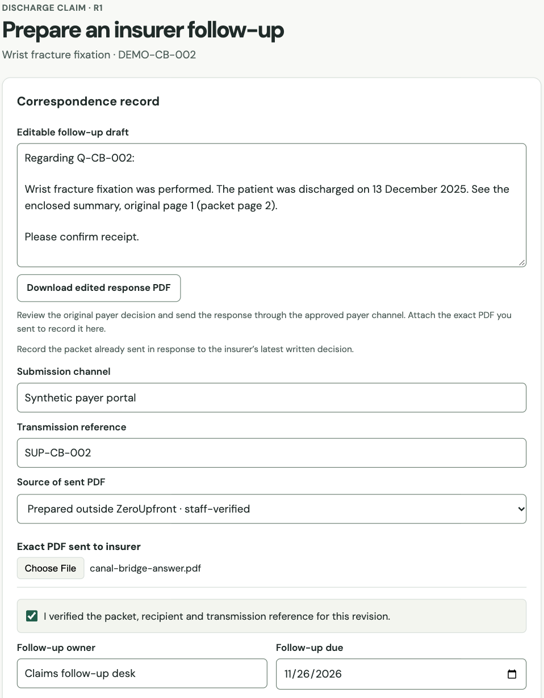

# Walk through ZeroUpfront

## Pre-arrival request

In the two-hospital demo, sign in to Canal Bridge as a hospital coordinator, open **Pre-arrival cases**, and select **Amelia Morgan · ZU-0248**. Choose **View cited clause** to see why Meridian Assist needs a signed report. Attach the signed sample, review form MA-IP-01, mark it reviewed and submit it. In the workspace menu choose **Switch to insurer desk** and sign in as the insurer reviewer. Open the received revision. The hospital can now find the same request under **Waiting for insurer**. The payment decision is pending. [Illustrated handoff](../README.md#coordinator-workspace) · [Run the 30-second recording](../demo/README.md)

## Discharge claim

### Live file upload

For a short presentation, start with Amelia. Her policy is already on file and **Attach signed sample report** supplies the missing document. To demonstrate a file from disk, open **Discharge claims → D-CB-001 → Correct packet documents** in Canal Bridge. Select the final itemized bill slot and upload the matching corrected synthetic bill. The original bill remains in revision history.

In a disposable rehearsal, uploading D-CB-002’s bill to D-CB-001 saved a held revision with both member and encounter mismatches and blocked staff approval. Uploading the correct D-CB-001 bill next produced a reviewable revision. For a new pre-arrival policy or rider, start a new intake with the policy, plan and estimate. An unfamiliar endorsement can require staff review. The existing estimate replacement action applies to the estimate only.

### Duplicate pharmacy charge

A hospital coordinator is preparing the final claim for a fictional wrist-fracture admission. The payer letter sets a THB 90,000 ceiling. The hospital's bill states THB 87,500, and one pharmacy charge appears twice. Can you find the original entry, correct the packet, and see exactly what the hospital would send?

Start the local coordinator workspace, then open **Discharge claims**. The digital practice case includes all four source PDFs and runs without an API key. [Setup and local workspace link](../README.md#run-the-demo) · [Earlier discharge walkthrough (MP4)](figures/discharge-walkthrough.mp4?raw=1) · [View the animation (GIF)](figures/discharge-walkthrough.gif)

In this earlier recording of the discharge interface, pause at **0:13** to read both THB 3,600 pharmacy lines on the original bill. At **0:29**, the corrected revision is ready for staff review. At **0:53**, the exported attachment shows the single remaining charge and the separate credit for returned supplies. [Still view of the coordinator workspace](figures/discharge-review.png)

## Try it as the hospital coordinator

| Step | What to do | What to look for |
| --- | --- | --- |
| 1. Find the charge | Choose **Try duplicate bill example**. On the new claim, open **Repeated invoice item** and select **Final itemized bill · p. 2**. | Revision R1 says **Needs investigation**. In the source viewer, invoice page 2 lists pharmacy item `MED01` for THB 3,600 twice. **Open PDF** opens the original at that page. |
| 2. Check billing's correction | Choose **Try corrected bill**. Preview the proposed PDF, confirm the files belong to this encounter, then choose **Save corrected packet**. | R2 says **Ready for staff review** and **No discrepancies recorded**. The final bill still states THB 87,500. To compare it with the earlier bill, choose **Version history**, open **R1**, then select **Open current claim** to return to R2. |
| 3. Sign off this revision | Choose **Review discharge packet**. Click an attachment to preview it. Tick the review confirmation, enter a reviewer name, and choose **Mark packet reviewed**. | The claim says **Staff reviewed**. The insurer disposition still says **Awaiting submission**. |
| 4. Inspect the export | Choose **Claim and attachments**. Click the bill filename to expand its inline preview. Choose **Open original PDF** to inspect it separately, or **Download reviewed claim** to save the reviewed packet. | The export identifies the case, revision and reviewer. Its PDF attachments panel contains the four original files for R2, including the corrected invoice. |

## Optional ending with a simulated payer decision

Use the same practice claim. Save the one-page fictional reply to your computer for step 2. It identifies member `EXAMPLE-2402`, encounter `EXAMPLE-VISIT-42`, and payer reference `REPLY-2`. [Download the fictional payer reply (PDF)](figures/demo-payer-reply.pdf?raw=1)

1. Choose **Back to claim**, then **Record claim submission**. Enter `Payer portal rehearsal` as the channel and `PORTAL-DC-42` as the reference. Enter the recorder's name and choose **Save record**. The insurer disposition changes to **Sent to insurer**.
2. Choose **Record payer reply**, enter `REPLY-2`, and select **Partially confirmed**. For the written terms, enter “We partially confirm THB 80,000 for this discharge claim.” Attach the downloaded PDF, confirm the encounter, and enter `80000` and `THB`. Set a follow-up owner and due date, then save. The decision amount appears alongside **No payment recorded**.
3. Choose **Record payment received**. Record `50000` in `THB`, reference `REMIT-1`, with a recorder name and a note such as “Simulated remittance.” Settlement shows **Partially paid**. Repeat with `30000` and `REMIT-2`. The two receipts total the payer's THB 80,000 decision, and settlement changes to **Paid**.

## Human review after a payer reply

In the staffed demo, **Discharge claims → VISIT-CB-002** opens a complete synthetic packet. A coordinator reviews it and records its submission before logging a written payer reply. For that case, use the [fictional written query](../fixtures/discharge/followup/canal-bridge-query.pdf) and the [matching three-page hospital answer](../fixtures/discharge/followup/canal-bridge-answer.pdf). The answer includes the original two-page discharge summary. Amelia’s separate pre-arrival request can remain pending throughout.

| What happened | What the coordinator does | What stays on file |
| --- | --- | --- |
| The insurer queried an item or issued a partial or declined decision | Open **Record payer reply**, enter the payer reference and written terms, attach the matching PDF, and name the follow-up owner and deadline. | The original payer document and its disposition are available on that revision. |
| The hospital answered or appealed | Open **Prepare query answer** or **Prepare appeal**. Check the original decision and correct the draft against the cited evidence. After transmission through the hospital’s approved channel, record the channel, reference and exact outgoing PDF. | A distinct record of what the hospital sent. A subsequent decision still comes from the payer. |
| A patient needs a financial update | Choose **Review patient update**, check the figures in English or Thai, enter the public billing contact and next update date, and save the reviewed copy. | A bilingual statement with reviewed figures. Posting a later receipt requires another review before a current copy can be downloaded. |

The illustrated response uses the supplied three-page answer. Choose **Prepared outside ZeroUpfront** and attest to the file that was sent. For a response composed in the app, choose **Download edited response PDF**. That file is tied to the specific written payer decision. Edits require a fresh download before recording transmission.

## Pattaya FX rehearsal

Bangkok Hospital Pattaya publishes a THB 239,000 multifocal lens replacement package covering both eyes and one inpatient night. The hospital describes checking the insurer’s guarantee and requesting an extension when costs or treatment change. The price and hospital workflow are public. The demo insurer, patient, approval, quotes and bank receipts are fictional. The scenario assumes the insurer has agreed to cover the whole package in THB, including any FX-related shortfall. [Published hospital package](https://www.bangkokhospital.com/en/pattaya/package/lens-replacement-surgery-package-bph) · [Hospital direct-billing process](https://www.bangkokhospital.com/en/pattaya/visit/insurance-bph)

1. In the staffed [hospital directory](http://127.0.0.1:8040/), choose Canal Bridge and open **VISIT-CB-FX**. Lakeside has its own **VISIT-LS-FX**. On the local rehearsal worklist, **Open Pattaya case** creates a fresh example.
2. The funding screen retrieves the historical USD/THB reference for the trade date. On 19 November 2026 the ECB reference from Frankfurter was **33.905 THB per USD**, equivalent to **USD 7,049.11** for THB 239,000 before fees. The public endpoint receives only the currency pair, date and publisher. If it is unavailable, retry or continue with the labeled simulated offers. [Frankfurter data source](https://frankfurter.dev/) · [Dated reference](https://api.frankfurter.dev/v2/rate/USD/THB?date=2026-11-19&providers=ECB)
3. Choose the simulated spot offer for delivery on 23 November or the simulated forward for delivery on 30 November. Confirm the booking. The accepted quote ID, price and delivery date stay in its recorded history. A changed offer requires a fresh confirmation. The THB 239,000 principal is still due to the hospital.
4. Under **Who covers the FX costs?**, open the payer letter, or choose **Read fee terms with OpenAI** to send that original PDF. Each supported answer includes the original-language passage and a button to open its physical page. Exchange differences and bank fees can have different payers. Silence, conflicting terms or an unverifiable citation require staff review. This action is also available for general discharge claims with an attached current confirmed or partial payer decision.
5. Compare the sending instruction with the receiving bank’s credit advice. Record the simulated **THB 238,700** receipt from the advice. This fictional guarantee explicitly assigns the remaining **THB 300** to the insurer. On the coordinator desk, record the simulated insurer instruction, then confirm the separate receiving-bank credit advice. The ledger shows payment in full after the second receipt. A duplicate instruction, missing original or mismatch in the case reference, currency or amount sends the case to finance review and blocks another credit.

The original settlement walkthrough includes two screenshots for comparison. [Earlier funding screen](figures/pattaya-funding.png) · [Earlier shortfall screen](figures/pattaya-settlement-shortfall.jpg)

A finance reviewer can inspect the balance of an assigned case. The hospital coordinator records the receiving-bank evidence and reviews the patient statement. [Finance access and assignments](deployment.md#configure-the-service)

The market-data lookup is free and requires no key. The optional original-letter read uses the server’s OpenAI project credentials, `WORKSPACE_ENABLE_AI_REVIEW=1` and the configured `OPENAI_MODEL`. For scanned originals, enable `WORKSPACE_ENABLE_OCR=1` for independent page transcription. Staff can inspect the PDF whenever either service is unavailable. In the multi-hospital app the hospital must also authorize that use. [Per-hospital cloud settings](hospital-workspaces.md#hospital-approval-for-external-document-processing) Actual trading and remittance require a contracted provider and confirmation of the beneficiary credit.

### How the guarantee reader was checked

The expanded first run held a letter that named the insurer on page 1 and assigned fees to that company on page 2. The reader now verifies and links both the role definition and the obligation. In the final live run, all 10 synthetic letters and all 20 exchange-difference or bank-fee outcomes matched their expected payer and page or their expected manual-review hold. The cases include a Thai scan, different payers for the two categories, a negation, conditional wording, conflicting pages and a silent letter. These examples exercise the implementation and do not establish accuracy on a hospital’s own guarantees. [Scored results](../bench/results/guarantee-fees.json) · [Synthetic cases and replay](../bench/guarantee_fees.py)

## Other ways to explore

The primary walkthrough uses a supported synthetic layout. The official Thai and US form rehearsals show how the workspace handles unfamiliar layouts, missing evidence and claims that still need manual review. The policy research tools separately exercise Thai and US pre-arrival packets, scans, retrieval, and page citations. [Thai form results](thai-payer-forms.md) · [US form results](us-payer-forms.md) · [Policy and fixture CLI commands](../CONTRIBUTING.md#optional-openai-workflows)

The team preserved its original browser-only study for readers interested in how the hospital and insurer screens evolved. [Archived design study](workspace-review/README.md)
