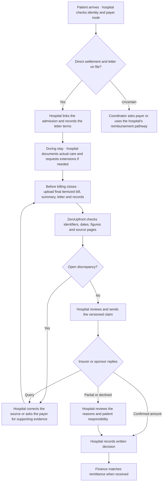

# Admission, discharge claim and settlement

**Use the discharge claim as the hackathon's main story.** Start with a planned inpatient admission at a Thai hospital and a payer that offers direct settlement. The hospital already has a preapproval or guarantee letter. The coordinator's job is to send an accurate claim for what actually happened. Keep pre-arrival review available to help prepare a request when the patient has no letter.

## Where the team's flow fits

Bangkok Hospital Phuket describes guarantees limited by dates, amounts or conditions, reauthorization when treatment changes, and insurers that await an itemized final bill. It also describes delays across time zones. Allianz's direct-settlement instructions request member details, actual service dates, diagnosis, itemized charges, discounts where applicable, the related guarantee, and an inpatient discharge summary. Those steps support screening the hospital's final packet. Allianz's separate preauthorization instructions concern the *planned* procedure and estimated cost. [Bangkok Hospital Phuket](https://www.bangkokhospital.com/en/phuket/page/international-patient-services-bpk) · [Allianz direct settlement](https://www.allianzcare.com/en/healthcare-providers/direct-settlement-process.html) · [Allianz preauthorization](https://www.allianzcare.com/en/support/healthcare-provider-resources/medical-provider-preauthorisation-process.html)

The hospital reviews the flags, corrects the documents and submits through the payer's channel. An insurer can request more information, accept part of the claim, confirm an amount or decline it. A confirmed amount and the remittance are two distinct facts. Medical clearance, patient discharge, claim submission and payment may happen at different times. Samitivej also describes patients who pay the hospital and file for reimbursement themselves. That path needs different paperwork, recipients and expectations. [Bangkok Hospital Phuket](https://www.bangkokhospital.com/en/phuket/page/international-patient-services-bpk) · [Samitivej international insurance](https://www.samitivejhospitals.com/patients-outside-thailand/planning-your-trip/insurance) · [Allianz direct settlement](https://www.allianzcare.com/en/healthcare-providers/direct-settlement-process.html)

## Trade-offs for the team

| Decision | Lead with discharge screening | Lead with pre-arrival authorization |
| --- | --- | --- |
| Immediate user and job | Billing coordinator checks actual charges against hospital records and the letter | International patient coordinator checks planned care and prepares a guarantee request |
| What a judge can verify | Follow a duplicate line to its bill page, correct the packet, inspect a payer query, distinguish approval from money received | Follow a policy clause to its source, supply a missing item, inspect a revised estimate |
| Value for the patient | Can reduce avoidable back-and-forth around final billing. Payer response and discharge time need a pilot to measure | Earlier evidence of direct billing and patient share can help the hospital decide the admission deposit |
| Workflow cost | Adds financial corrections, multiple document versions, queries and reconciliation. Final inpatient records may arrive late | Uses fewer documents earlier. Estimates and authorizations can become stale during the stay |
| Validation needed | Payer-specific billing forms, coding, policies, records and remittances, plus hospital billing-team feedback | Verified plan, rider, provider eligibility, insurer channels and admissions-team feedback |
| Promise to make | “Find discharge claim discrepancies and show the evidence before submission.” | “Prepare a sourced preauthorization request and track the written response.” |

**A sponsor can have different rules.** The cited processes describe insurance. An employer, embassy or other sponsor needs a separate accepted format, signatory and payment undertaking before it belongs in the same automated pathway.

## What can fail and who can resolve it

| Checkpoint | Example | Owner and action |
| --- | --- | --- |
| Payer route | A member shows a card but the hospital lacks direct billing for this plan | Hospital checks the payer channel or prepares the patient's reimbursement documents. |
| Identity and authority | Similar patient name, wrong encounter, missing consent or unsigned authorization | Hospital checks member identifiers, visit and evidence of authority. Escalate policy-dependent consent rules. |
| Inpatient stay | Extra nights, changed procedure, different hospital or expired guarantee | Hospital seeks written terms or extension. Record what the letter actually covers. |
| Documents | Bill still provisional, missing signature, incomplete discharge summary, illegible scan or absent record | Ask the author for a final, signed, legible version applicable to the encounter. |
| Amounts | Duplicate line, unexplained credit, discount applied twice, tax difference, round-off or currency mismatch | Billing reconciles the original ledger in its stated currency. A reused billing code can be legitimate. |
| Coverage and proof | Patient share, cap, excluded supply, missing rider or item without supporting documentation | Coordinator cites the controlling text and obtains payer clarification. Clinical necessity belongs to the treating team and payer. |
| Submission and query | Incorrect transmission channel, duplicate send, filing deadline, late reply or superseded invoice | Staff record external references and link each response to its exact packet. A sending receipt and payer agreement are distinct events. |
| Finance | Partial decision, no remittance, short/combined payment or denial under appeal | Record the written outcome. Finance reconciles the actual payment and follows the payer's review process. |

Hospitals and products differ. The published US service-benefit brochure, for example, specifies separate overseas filing instructions and pharmacy-claim timing. Deadlines and remedy paths must come from the applicable contract. The sources establish the real workflow. They provide no measured ZeroUpfront denial rate, waiting-time improvement or guarantee of coverage. [2026 US Service Benefit Plan, sections 5(i), 7 and 8](https://www.opm.gov/healthcare-insurance/healthcare/plan-information/plans/pdf/2026/brochures/71-005.pdf)
