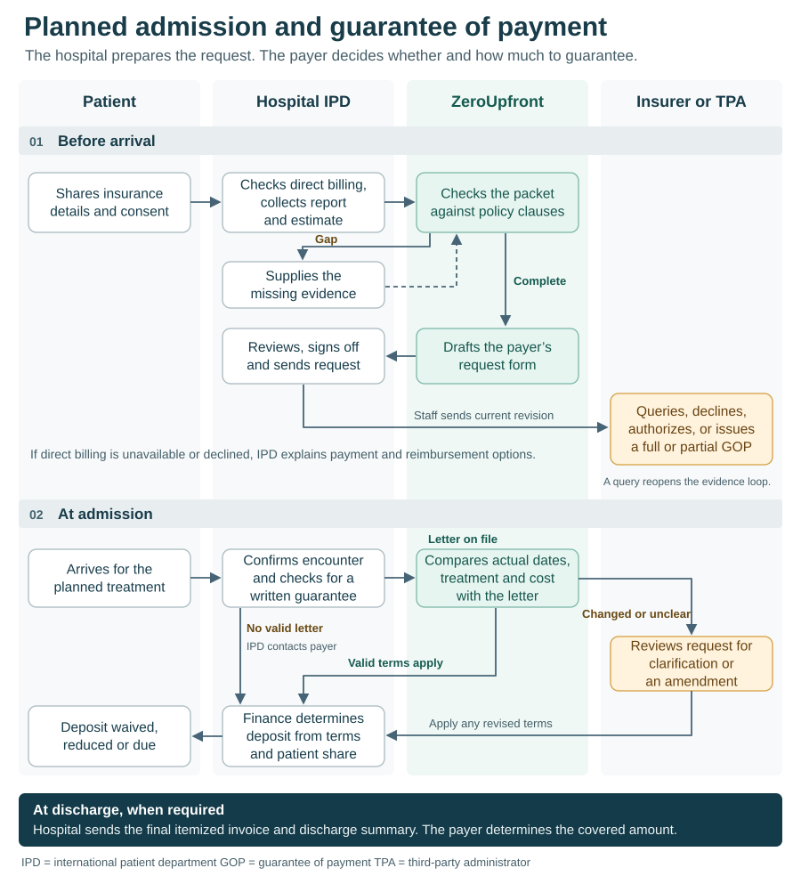

# From planned admission to direct billing

The team's four lanes fit a planned international admission. The alternative keeps the patient, hospital international patient department (IPD), ZeroUpfront and insurer or third-party administrator (TPA), along with the loop that returns missing exhibits to the hospital. It shows the evidence for preauthorization, a written payment guarantee and the hospital's deposit decision.

[Original team diagram](figures/planned-admission-team-original.png)

[Full-resolution PNG for the team's slides and documents](figures/planned-admission-flow.png)

| Stage | Owner and handoff |
| --- | --- |
| Before arrival | Patient shares insurance details and consents to the hospital contacting the payer. IPD identifies the encounter, checks the hospital's direct-billing arrangement and collects the plan, medical report, estimate in its original currency and payer-specific exhibits. A missing consent or unknown arrangement needs an explicit owner. |
| Prepare the request | ZeroUpfront checks the applicable policy and riders, shows the clauses and evidence, and lists any missing information. IPD corrects the same case and signs off the current revision. The hospital records submission separately from staff approval. |
| Insurer review | The insurer or authorized TPA can ask for information, decline, authorize treatment, or issue a full or partial written guarantee. Record the actual reply and the submitted revision. Capture covered services, facility, amount, currency, validity dates and patient share when stated. Missing terms stay unknown. |
| At admission | IPD compares the admitted encounter, dates, treatment and amount to the actual letter. If the letter applies, follow its terms. If absent, expired, ambiguous or affected by a material change, staff request clarification, an initial guarantee or an amendment. Preserve the earlier letter and the amount it covered. |
| Patient and discharge | Hospital finance confirms whether a deposit is waived, reduced or required. A deductible or non-covered item can remain payable. If the payer requires a final invoice or discharge summary, the hospital sends it at discharge for final confirmation and settlement. |

**Why the branches matter.** Allianz asks providers for planned dates, diagnosis, procedure, estimated costs and supporting medical information before its decision. Its separate settlement process calls for an itemized invoice, inpatient discharge summary and any related guarantee. It assigns patient shares and excluded charges to the provider to collect. [Allianz preauthorization](https://www.allianzcare.com/en/support/healthcare-provider-resources/medical-provider-preauthorisation-process.html) · [Allianz direct settlement](https://www.allianzcare.com/en/healthcare-providers/direct-settlement-process.html)

Bangkok Hospital Phuket describes requesting an adjustment when treatment changes or costs approach the approved limit. It also describes payers that issue their final guarantee after inspecting the final invoice. Bumrungrad's guidance distinguishes direct billing from reimbursement and describes deposit handling while a letter is outstanding. Verify the timing and permitted payer response types with the participating hospital and insurer. [Bangkok Hospital Phuket](https://www.bangkokhospital.com/en/phuket/page/international-patient-services-bpk) · [Bumrungrad](https://www.bumrungrad.com/en/insurance-information-guides?docid=101915)

## The hackathon demonstration

Start with the team's first half. In synthetic Z002, show the missing estimate breakdown, its source clause, the corrected estimate on the same case, staff review, and the insurer-formatted **request** and gap report. Keep **No insurer response on file** visible until a separate document arrives. The admission comparison only makes sense once a specific insurer response is recorded. A future demonstration can use an explicitly simulated letter to show both an unchanged admission and a changed plan that needs an amendment.

In the alternative pitch diagram, the coordinator compares the admission with the insurer's letter and drafts an amendment when needed. The hospital confirms whether a deposit is waived, reduced or due. A zero-deposit admission is one successful branch. Compare time to a correctly prepared request in the [coordinator pilot](coordinator-pilot.md). Track insurer turnaround and hospital-recorded deposits separately.
