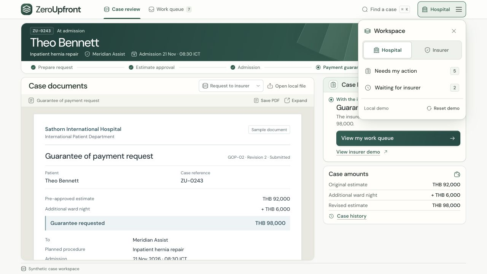

# Hospital and insurer design review

These two interactive pages show the pre-arrival coverage review and guarantee of payment handoff. The cases are fictional. Decisions in this prototype are saved in the browser.



## Try the handoff

From the repository root, run the following command. Python 3 is the only dependency.

```sh
python3 -m http.server 8000 --bind 127.0.0.1 --directory docs/workspace-review
```

1. Open the [hospital work queue](http://127.0.0.1:8000/hospital.html#view=index&case=ZU-0243) and choose **Theo Bennett**. The case shows the guarantee request and who owns the next action.
2. Open **Hospital** at the top right and switch to **Insurer**. The same case opens for review. Compare the requested THB 98,000 with the earlier THB 92,000 estimate.
3. Open the workspace menu again and select **Needs my action** to see the insurer’s pending cases. On a phone, use **Next action** and **Documents** to move between the case decision and its evidence.

To inspect the original synthetic project PDFs, open the [Z002 hospital case](http://127.0.0.1:8000/hospital.html#case=Z002). Both HTML files also work offline when opened from the same folder.
